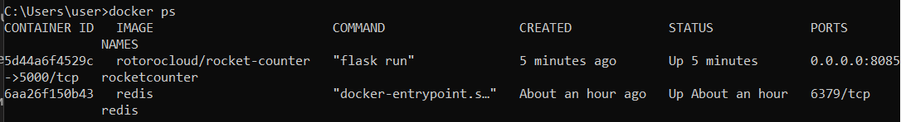
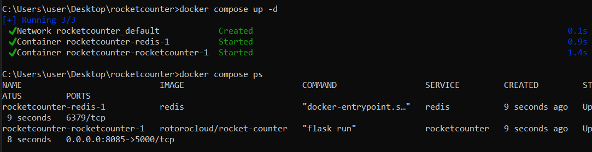
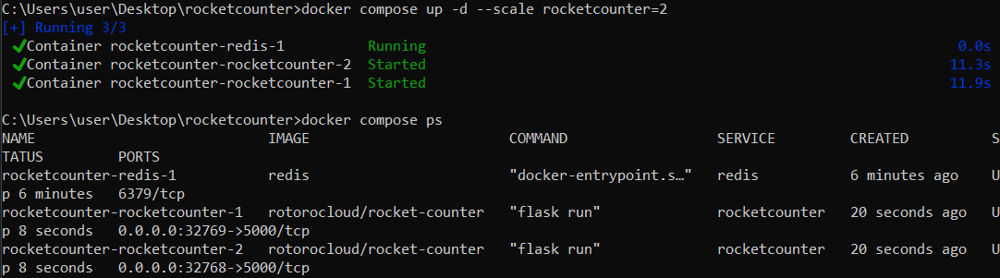
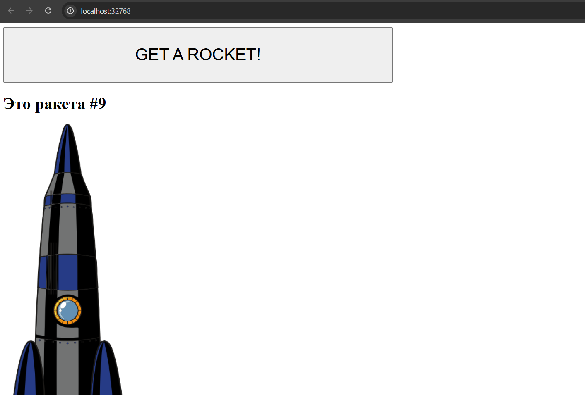
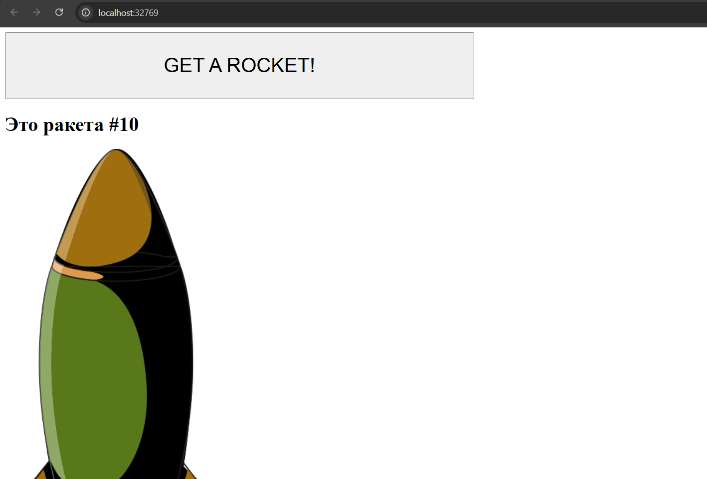
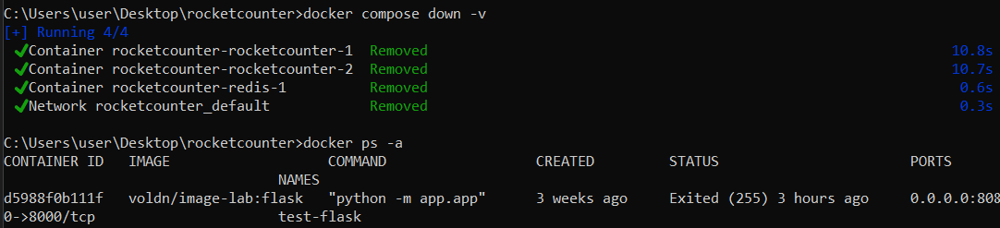

# ЛР: Redis + Rocket Counter

От `docker run` к `docker compose` и масштабированию.

## Цель

- Запуск контейнеров с параметрами (имя, порты, связи)
- Работа с устаревшим `--link`
- Описание стека в `docker-compose.yml`
- Масштабирование сервисов и корректное завершение стека

## Структура репозитория

```
rocketcounter/
├── docker-compose.yml
├── README.md
└── screenshots/
    ├── 01_docker_run_ps.png
    ├── 02_docker_run_page.png
    ├── 03_compose_ps.png
    ├── 04_compose_page.png
    ├── 05_scale_ps.png
    ├── 06_scale_page1.png
    ├── 07_scale_page2.png
    └── 08_down.png
```

## Часть 1. Ручной запуск

```bash
docker run -d --name redis redis
docker run -d --name rocketcounter --link redis:redis -p 8085:5000 rotorocloud/rocket-counter
docker ps
curl -s localhost:8085 | head
```




Удаление:

```bash
docker rm -f redis rocketcounter
```

## Часть 2. docker compose

`docker-compose.yml`:

```yaml
services:
  redis:
    image: redis

  rocketcounter:
    image: rotorocloud/rocket-counter
    ports:
      - "0:5000"
    depends_on:
      - redis
```

Запуск:

```bash
docker compose up -d
docker compose ps
curl -s localhost:8085 | head
```




## Часть 3. Масштабирование

```bash
docker compose up -d --scale rocketcounter=2
docker compose ps
```



Экземпляры на разных портах, счётчик общий (один Redis):





## Часть 4. Уничтожение стека

```bash
docker compose down -v
```



Контейнеры и сеть проекта удалены.

## Ответы на вопросы

1. `--link` в Ч.1 использовался для ручной связки контейнеров (устаревший способ). В Compose он не нужен: сервисы в одной сети по умолчанию и обращаются друг к другу по имени сервиса.

2. `image` — готовый образ из registry. `build` — сборка образа из Dockerfile в указанном контексте.

3. На одном хосте нельзя опубликовать один и тот же фиксированный порт на несколько реплик. Обходы: динамические порты (`"0:5000"`), reverse proxy / load balancer, оркестратор (Swarm, Kubernetes).

4. `docker compose down -v` останавливает и удаляет контейнеры, сети и тома, объявленные в compose-файле. Без `-v` тома сохраняются.

5. Compose создаёт сеть проекта. Имя сервиса становится DNS-именем внутри этой сети (например, приложение обращается к `redis:6379`).
