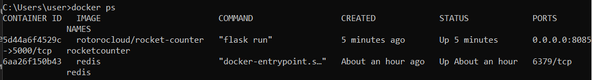
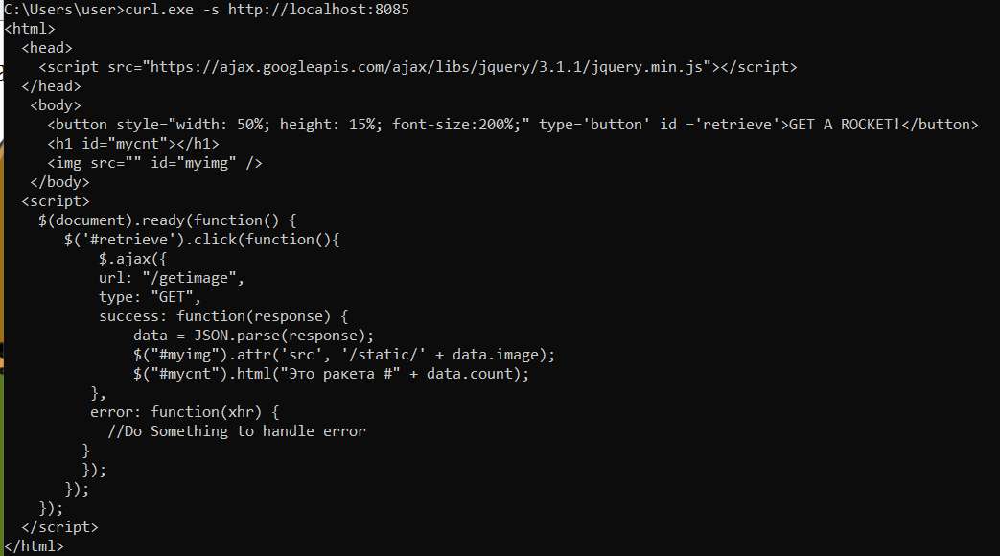
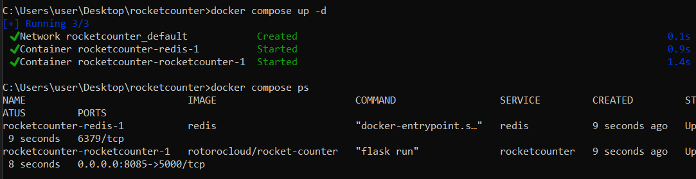
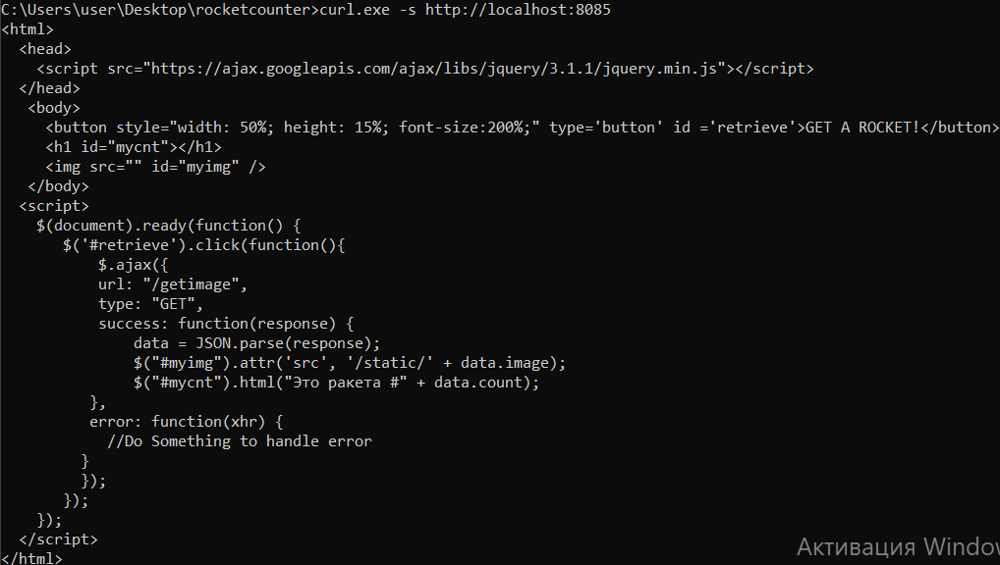
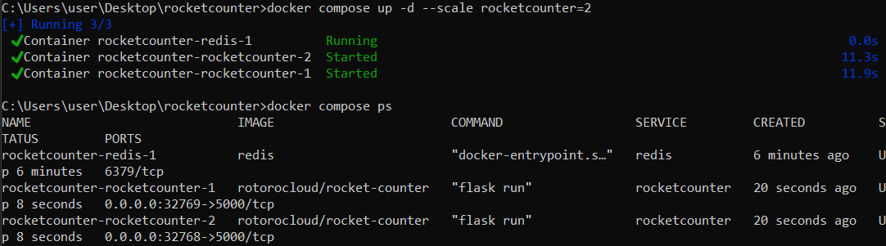
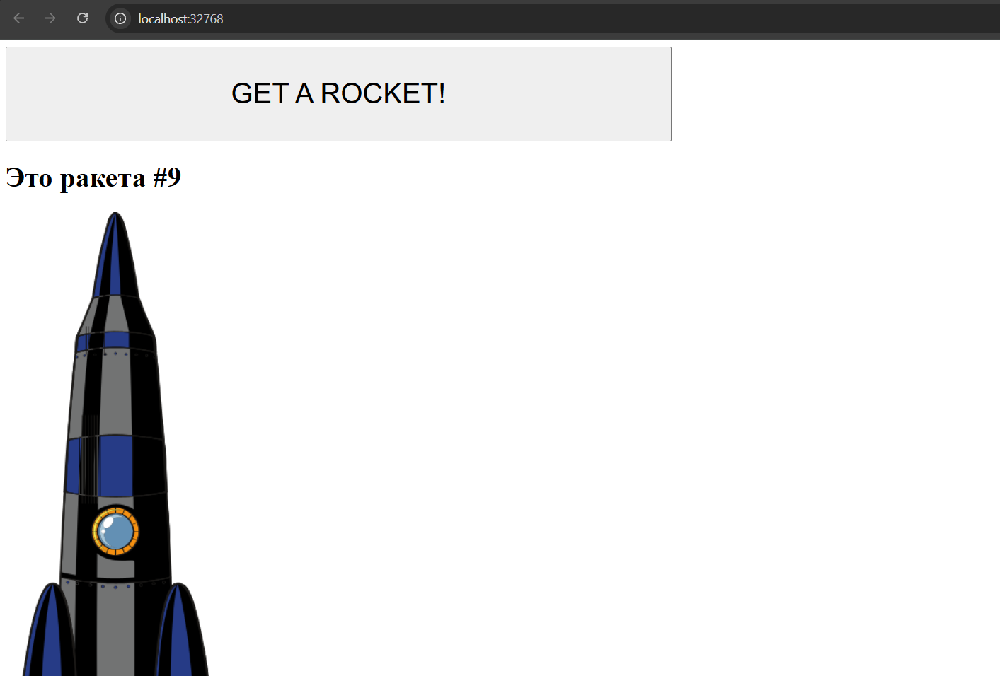
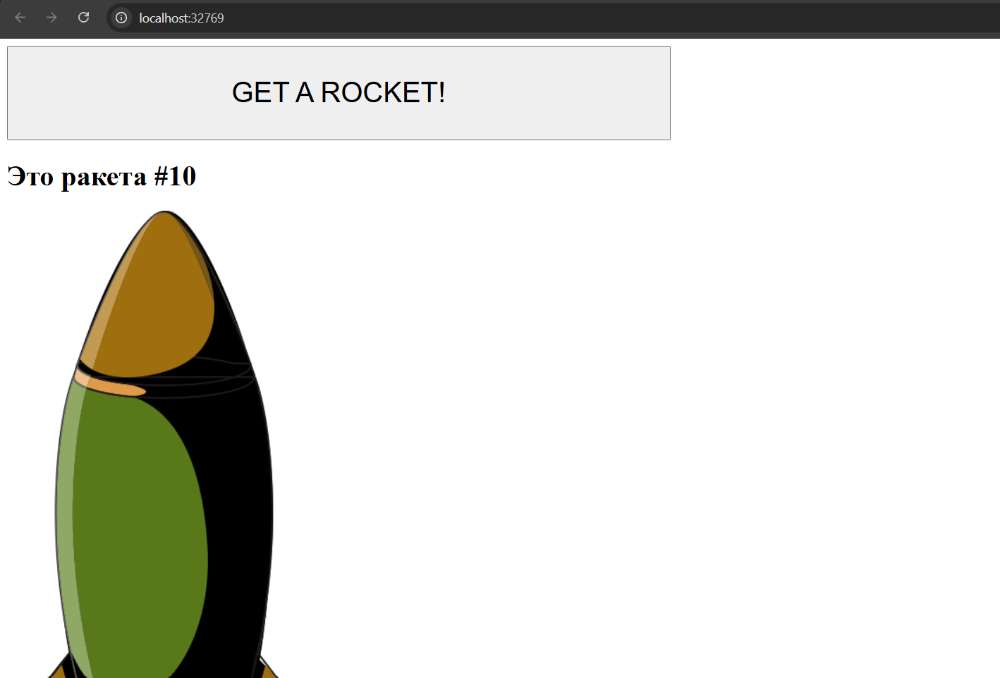
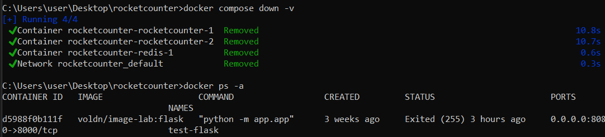

# ЛР: Redis + Rocket Counter

От `docker run` к `docker compose` и масштабированию.

## Цель

- Запуск контейнеров с параметрами (имя, порты, связи)
- Работа с устаревшим `--link`
- Описание стека в `docker-compose.yml`
- Масштабирование сервисов и корректное завершение стека

## Структура репозитория

```
rocketcounter/
├── docker-compose.yml
├── README.md
└── screenshots/
    ├── 01_docker_run_ps.png
    ├── 02_docker_run_page.png
    ├── 03_docker_run_curl.png
    ├── 04_compose_ps.png
    ├── 05_compose_page.png
    ├── 06_compose_curl.png
    ├── 07_scale_ps.png
    ├── 08_scale_page1.png
    ├── 09_scale_page2.png
    └── 10_down.png
```

---

## Часть 1. Ручной запуск (`docker run`)

```bash
docker run -d --name redis redis
docker run -d --name rocketcounter --link redis:redis -p 8085:5000 rotorocloud/rocket-counter
docker ps
```



Проверка curl:

```bash
curl.exe -s http://localhost:8085
```

```html
<html>
<head>
<script src="https://ajax.googleapis.com/ajax/libs/jquery/3.1.1/jquery.min.js"></script>
</head>
<body>
  <button ... id='retrieve'>GET A ROCKET!</button>
  <h1 id="mycnt"></h1>
  
</body>
...
</html>
```



Страница в браузере: http://localhost:8085


Удаление:

```bash
docker rm -f redis rocketcounter
```

---

## Часть 2. docker compose (фиксированный порт)

На этом этапе использовался **фиксированный** порт `8085:5000`.

`docker-compose.yml` (версия для Части 2):

```yaml
services:
  redis:
    image: redis

  rocketcounter:
    image: rotorocloud/rocket-counter
    ports:
      - "8085:5000"
    depends_on:
      - redis
```

Запуск:

```bash
docker compose up -d
docker compose ps
```



Проверка curl:

```bash
curl.exe -s http://localhost:8085
```

```html
<html>
<head>
<script src="https://ajax.googleapis.com/ajax/libs/jquery/3.1.1/jquery.min.js"></script>
</head>
<body>
  <button ... id='retrieve'>GET A ROCKET!</button>
  <h1 id="mycnt"></h1>
  
</body>
...
</html>
```




---

## Часть 3. Масштабирование (динамические порты)

Для масштабирования на одном хосте фиксированный порт `8085` нельзя опубликовать на несколько реплик.  
Поэтому публикация портов изменена на динамическую:

`docker-compose.yml` (финальная версия, в репозитории):

```yaml
services:
  redis:
    image: redis

  rocketcounter:
    image: rotorocloud/rocket-counter
    ports:
      - "0:5000"
    depends_on:
      - redis
```

```bash
docker compose up -d --scale rocketcounter=2
docker compose ps
```



У экземпляров разные хост-порты (например `32768` и `32769`). Счётчик общий (один Redis):





---

## Часть 4. Уничтожение стека

```bash
docker compose down -v
```



Контейнеры и сеть проекта удалены.

---

## Когда менялась публикация портов

| Этап | Порты | Причина |
|------|-------|---------|
| Часть 1 (`docker run`) | `8085:5000` | Фиксированный порт для ручного запуска |
| Часть 2 (`compose`) | `8085:5000` | Та же схема, один экземпляр |
| Часть 3 (scale) | `0:5000` | Динамические порты, чтобы поднять 2 реплики на одном хосте |

В репозитории лежит **финальная** версия `docker-compose.yml` с `"0:5000"`. Версия с `"8085:5000"` использовалась на Части 2 и показана выше.

---

## Ответы на вопросы

1. `--link` в Ч.1 использовался для ручной связки контейнеров (устаревший способ). В Compose он не нужен: сервисы в одной сети по умолчанию и обращаются друг к другу по имени сервиса.

2. `image` — готовый образ из registry. `build` — сборка образа из Dockerfile в указанном контексте.

3. На одном хосте нельзя опубликовать один и тот же фиксированный порт на несколько реплик. Обходы: динамические порты (`"0:5000"`), reverse proxy / load balancer, оркестратор (Swarm, Kubernetes).

4. `docker compose down -v` останавливает и удаляет контейнеры, сети и тома, объявленные в compose-файле. Без `-v` тома сохраняются.

5. Compose создаёт сеть проекта. Имя сервиса становится DNS-именем внутри этой сети (например, приложение обращается к `redis:6379`).
